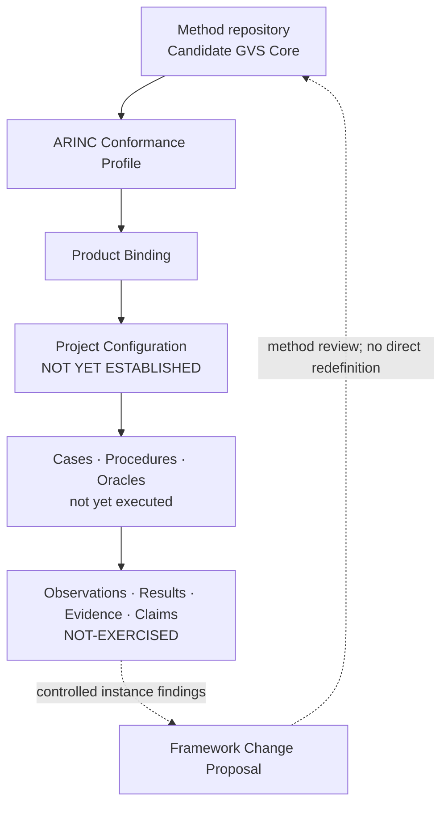

# ARINC 615A Conformance Verification

This repository owns the ARINC 615A **Profile, Product Binding, Project
Configuration, instance engineering, execution records and instance evidence**
used to apply a separately controlled generic verification methodology. It
develops an auditable Test-and-Analysis approach, with Review and Inspection
gates controlling artifacts and claims.

The root README is the sole human-readable current-status surface. Atomic
baselines, change requests, reviews and historical evidence remain immutable
records at commit-bound locations.

## Project architecture



The method repository owns the Generic Core. This repository owns the ARINC
refinement and all configuration- and execution-specific artifacts. Instance
findings may support, qualify or challenge candidate method claims, but cannot
silently redefine the Core.

<!-- project-status:start -->
## Current development picture

| Dimension | Controlled state |
|---|---|
| Repository role | ARINC 615A Profile / Binding / Configuration / instance engineering and evidence owner |
| Current release | [`RB-2026-001-v4.3.1`](docs/control/baselines/RB-2026-001-v4.3.1.md) / annotated [`v4.3.1`](https://github.com/ZhangChi0727/arinc-615a-conformance/tree/v4.3.1) |
| Method input | Candidate GVS Core 0.3 at [`48dd8232b7ef`](https://github.com/ZhangChi0727/complex-system-verification-assurance/commit/48dd8232b7efe6b0dba3fcb75dfc154d034d2b0b) |
| Protocol source | `ARINC-615A-3` / edition `615A-3` / wire version `A4` |
| Bounded source and open dependency | `ARINC-665-5`, `ARINC-664-2`, `ARINC-664-3`, `ARINC-645` (BOUNDED-ACTIVE); `ARINC-664-4`, `ARINC-664-7` (CONDITIONAL-DEPLOYMENT); ARINC-645 `OPEN-DEPENDENCY`, ARINC-664-3 `OPEN-DEPENDENCY`, ARINC-664-4 `OPEN-DEPENDENCY`, ARINC-664-7 `OPEN-DEPENDENCY`, RFC-768 `OPEN-DEPENDENCY`, RFC-791 `OPEN-DEPENDENCY`, RFC-1123 `OPEN-DEPENDENCY`, RFC-1350 `OPEN-DEPENDENCY`, RFC-1785 `OPEN-DEPENDENCY`, RFC-2347 `OPEN-DEPENDENCY`, RFC-2348 `OPEN-DEPENDENCY`, RFC-2349 `OPEN-DEPENDENCY`, RFC-1122 `OPEN-DEPENDENCY` |
| Technical direction | `LIGHTWEIGHT-OBSERVABLE-TIMED-EFSM` / `CL-TAV` / platform `deferred: TTCN-3` |
| Delivery position | current `M2` / next `M3` / disposition `ADOPT` |
| Activation boundary | merge evidence `EXTERNAL-VERIFICATION-REQUIRED` / approval `NOT-AUTOMATED` |
| Technical controls | [`source register`](configs/research/controlled_sources.json), [`activation control`](docs/control/changes/CR-2026-012.md), [`technical decisions`](docs/control/decisions/DESIGN_DECISIONS.md), [`M1 package`](configs/requirements/arinc_615a3_m1_crs.json), [`generated M1 review view`](docs/control/requirements/ARINC615A3_M1_CRS_REVIEW_VIEW.md), [`M2 package`](configs/models/arinc_615a3_m2_model.json), [`generated M2 review view`](docs/control/models/ARINC615A3_M2_MODEL_REVIEW_VIEW.md) |
| Current CRS inventory | `ARINC615A3-M1-CRS` / `M1-CANDIDATE-25` / coverage 3153 / requirements 863 |
| Third handshake | `COMPLETE` |
| Compatibility | `REVIEWED-COMPATIBLE-WITH-QUALIFICATION` under Q-01–Q-09 |
| Project Configuration | `NOT YET ESTABLISHED` |
| Instance evaluation | `NOT-EXERCISED` |
| RQ8 | `OPEN` |

## Current increment

**Draft SIMULATED-IUT confirmatory design: interval-only visibility and v2 hypothesis model; not yet registered**

- CR-2026-017 / DD-041 delivered the separately owned, read-only offline capture-to-evidence increment merged as eddec443; its bounded evidence scope remains unchanged.
- CR-2026-018 / DD-042 integrated accepted literature evidence into bounded C1/C2 wording and evaluation accounting without changing algorithms, interfaces or experiment arms.
- PR #23 was independently accepted at Head 04b7c56eb70e458cec46e54bd7b37aaa9185cc7f and squash-merged as 868ee3c3e99bee2bcb0a2aedb206fe15d2a4e0e9; main CI 38864201591 passed. CR-2026-019 / DD-043 remains a bounded design authority, not run admission.
- PR #24 was merged as 4d3b013; CR-2026-020 / DD-044 governs its versioned editable model-figure candidates. The current nine remain DRAFT-REDRAW candidates; semantic review, final-size acceptance, downstream migration, and promotion remain separate pending human decisions.
- PR #25 was independently accepted and squash-merged as c577f34e. It introduced the bounded finite CL-TAV reference-runtime foundation: verified contract/model/projection identities, one-clock exact-rational propagation, conservative limits, compact content-addressed source records, contract-bound in-process session coordination, and raw observation ownership/timing assessment. It establishes neither runtime integrity, IUT execution, conformance, nor M3 admission.
- Draft PR #26 has limited-accepted C-stage session integration at 7fd917b9 and limited-accepted D-stage cltav-615a-engineering delivery at 1012f673 (independent evidence envelope, run/verify/replay CLI, transactional directory publish, non-editable-wheel installation); E closeout awaits DM whole-branch review. DM-C-R01: after UNKNOWN and an admissible Recover, the full session conservatively stops at Stop-Prediction-Gap without promoting conservative H or continuing diagnosis; that is a later method item. This is not complete UPLOAD, real IUT/network evidence, four-arm or experiment results; CRC/integrity remains NOT-ESTABLISHED.
- CR-2026-024 / DD-048 adds a Draft SIMULATED-IUT Phase A instrument: bound-model FIND/SEND/ABORT/INFORMATION, declared H_single injection with confirmation, fail-closed evaluator truth, reset evidence, and a simulated clock with declared epsilon. It is labelled SIMULATED-IUT / non-confirmatory; it does not fill manuscript results, close DEC-IUT/DEC-TRUTH/DEC-CLOCK.
- CR-2026-025 / DD-049 adds the Draft Phase B four-arm adapter: CL-T predetermined TEST, CL-A analysis-only, CL-TA frozen test-then-analysis, and CL-LOOP via existing ReferenceSession. Arms never see truth, fault plans, or other-arm records. It does not fill manuscript results or start Phase C/D.
- CR-2026-026 / DD-050 adds the Draft Phase C E0-E6 pipeline (SCENE, INJECT, TRUTH, RUN, COLLECT, FILTER, EVAL), SYN-* walkthrough tests with registered mismatch tables, mixed VALID {h_normal,...} → INCONCLUSIVE, and a registration-shaped pilot config with N and seeds pending Phase D. Truth is EVAL-only.
- CR-2026-027 / DD-051 closes DEC-IUT as the local simulated 615A environment (TH / FIND-HOST). Results remain labelled SIMULATED-IUT. DEC-TRUTH, DEC-CLOCK, DEC-EQUIV, DEC-SAMPLE and DEC-RESOURCE stay OPEN.
- configs/research/cltav_pilot_config_v1.json pre-declares 120 cells (catalogue applicable (scene, fault) x 4 arms), N=3, seeds [1001,1002,1003], ROUNDS remaining=8. The census is written under artifacts/pilot/ as PILOT / SIMULATED-IUT development lineage and must not be reused as confirmatory data.
- PR #28 was merged as 4e34165 with a merge commit that keeps the reviewed SHAs, including pilot pre-declaration d6786da. CR-2026-028 / DD-052 adds the confirmatory design draft: arms see only observation intervals (S1), cltav_confirmatory_hypothesis_model_v2.json adds boundary and near-boundary variants, and configs/research/cltav_confirmatory_design_draft_v1.json declares 78 units x 4 arms = 312 cells with N=1. CR-2026-029 / DD-053 records the C1, E3, S1, R1 and T3 rulings and treats a delayed LUR ACK as an H-NORMAL timing perturbation without inventing a deadline. The design is not yet registered or frozen, and no confirmatory run has started.
- CR-2026-030 / DD-054 registers the confirmatory experiment; frozen on merge as e987145.
- CR-2026-031 / DD-055 adds the confirmatory runner and analysis scripts without changing the frozen registration and no confirmatory run has started.
- No confirmatory result, Configuration, expanded capability, conformance, submission, baseline or tag is created.

State changes:

- The bounded offline intake remains the accepted narrow engineering increment and closes no run-admission dependency.
- The finite experiment design is accepted as a design attachment while all run-admission decisions remain OPEN.
- The CR-2026-020 / DD-044 redraw workflow remains DRAFT-REDRAW; reader-figure promotion remains blocked pending the separate semantic, size, migration and promotion gates.
- PR #25 is merged as the bounded finite reference-runtime foundation; it is not a runtime-integrity result or authority for M3, active execution, or capability claims.
- Draft PR #26 has limited-accepted C (7fd917b9) and D (1012f673); E closeout awaits DM whole-branch review and establishes no experiment admission.
- CR-2026-024 / DD-048 Phase A remains the SIMULATED-IUT instrument; CR-2026-025 / DD-049 Phase B remains the four-arm adapter; CR-2026-026 / DD-050 Phase C remains the E0-E6 pipeline; CR-2026-027 / DD-051 closes DEC-IUT only. This is not confirmatory evidence.
- CR-2026-028 / DD-052 and CR-2026-029 / DD-053 define a confirmatory design draft only; registration, freeze and confirmatory runs remain pending.
- CR-2026-030 / DD-054 registers the confirmatory experiment; frozen on merge as e987145.
- CR-2026-031 / DD-055 adds the confirmatory runner and analysis scripts without changing the frozen registration and no confirmatory run has started.
- currentStop remains EXECUTABLE-FOUNDATION-GATE for M3, active execution and capability claims.

Unchanged boundaries:

- Candidate GVS Core and compatibility-disposition identities remain separate and unchanged.
- The 18 source mapping rows, 7 instance-only rows and Q-01 through Q-09 remain unchanged.
- Project Configuration is NOT YET ESTABLISHED; instance evaluation is NOT-EXERCISED; RQ8 remains OPEN.
- Protocol conformance, certification readiness and authority acceptance remain false; no baseline or tag is created.
- The merged finite reference runtime and Draft PR #26 scenario contract remain bounded engineering artifacts only; they create no active codec/service engine, general solver, verification verdict, controlled IUT execution evidence or Project Configuration.

## Current stop

`EXECUTABLE-FOUNDATION-GATE` — **NOT YET ESTABLISHED**: This stop still blocks M3, active protocol execution, runtime-integrity claims and capability claims. RR-CLTAV-2026-097 accepted the first-slice offline UPLOAD/INFORMATION development specification at PR #19 Head c9ca381, squash-merged as 324d832; PR #20 rebounded the M2 input to c5296aed. CR-2026-017 / DD-041 separately authorize only a bounded, read-only offline intake implementation with evidence output. PR #25 is merged as the bounded finite reference-runtime foundation. Draft PR #26 has limited-accepted C-stage session integration and D-stage engineering delivery; E closeout awaits DM whole-branch review. UNKNOWN after Recover stops at Stop-Prediction-Gap (DM-C-R01) and is not post-recovery continued diagnosis. CR-2026-024 / DD-048 Phase A is a SIMULATED-IUT instrument only; CR-2026-025 / DD-049 Phase B is a four-arm adapter only; CR-2026-026 / DD-050 Phase C is an E0-E6 pipeline only; CR-2026-027 / DD-051 closes DEC-IUT as the local simulated environment while DEC-TRUTH, DEC-CLOCK, DEC-EQUIV, DEC-SAMPLE and DEC-RESOURCE remain OPEN. None of this is a runtime-integrity result, confirmatory experiment, real protocol-service ownership, physical clock calibration, Project Configuration, expanded-CRS approval or M3 activation. M1-CANDIDATE-25 and its open source dependencies retain their controlled dispositions.

## Next development steps

- Retain PR #24's controlled model-figure candidates as DRAFT-REDRAW; do not promote reader figures or migrate downstream consumers until the separate semantic, size, migration and promotion gates close.
- Complete independent D-stage review of Draft PR #26 on one fixed candidate Head before E-stage whole-PR gates; do not treat the engineering CLI as authority for M3, controlled IUT execution, post-recovery continued diagnosis, or runtime-integrity work.
- Independently review the Phase D SIMULATED-IUT / PILOT census on one fixed Head; do not reuse these rows as confirmatory data; keep DEC-TRUTH, DEC-CLOCK, DEC-EQUIV, DEC-SAMPLE and DEC-RESOURCE OPEN.
- Write and freeze the confirmatory registration (cells, primary and secondary metrics, contrasts, multiplicity, decision and stopping rules, code SHA and config hashes) before any confirmatory run; never reuse pilot rows.
- Keep every experiment run-admission decision OPEN and establish runtime integrity and independent truth before capability or conformance claims; do not start M3 from the accepted design alone.
- Keep protocol capability and execution boundaries unchanged. The local corpus remains exploratory; unknown topology, clocks, configuration, version and root cause remain explicit, and no capture annotation becomes experimental truth.

## 当前开发图景

| 维度 | 受控状态 |
|---|---|
| 仓库角色 | ARINC 615A Profile、Binding、Configuration、实例工程与证据的权威仓库 |
| 当前发布 | [`RB-2026-001-v4.3.1`](docs/control/baselines/RB-2026-001-v4.3.1.md) / annotated [`v4.3.1`](https://github.com/ZhangChi0727/arinc-615a-conformance/tree/v4.3.1) |
| 方法输入 | Candidate GVS Core 0.3 @ [`48dd8232b7ef`](https://github.com/ZhangChi0727/complex-system-verification-assurance/commit/48dd8232b7efe6b0dba3fcb75dfc154d034d2b0b) |
| 协议来源 | `ARINC-615A-3` / 版次 `615A-3` / 线版本 `A4` |
| 有边界来源与开放依赖 | `ARINC-665-5`, `ARINC-664-2`, `ARINC-664-3`, `ARINC-645` (BOUNDED-ACTIVE); `ARINC-664-4`, `ARINC-664-7` (CONDITIONAL-DEPLOYMENT)；ARINC-645 `OPEN-DEPENDENCY`, ARINC-664-3 `OPEN-DEPENDENCY`, ARINC-664-4 `OPEN-DEPENDENCY`, ARINC-664-7 `OPEN-DEPENDENCY`, RFC-768 `OPEN-DEPENDENCY`, RFC-791 `OPEN-DEPENDENCY`, RFC-1123 `OPEN-DEPENDENCY`, RFC-1350 `OPEN-DEPENDENCY`, RFC-1785 `OPEN-DEPENDENCY`, RFC-2347 `OPEN-DEPENDENCY`, RFC-2348 `OPEN-DEPENDENCY`, RFC-2349 `OPEN-DEPENDENCY`, RFC-1122 `OPEN-DEPENDENCY` |
| 技术方向 | `LIGHTWEIGHT-OBSERVABLE-TIMED-EFSM` / `CL-TAV` / 平台 `deferred: TTCN-3` |
| 交付位置 | 当前 `M2` / 下一 `M3` / 处置 `ADOPT` |
| 激活边界 | 合并证据 `EXTERNAL-VERIFICATION-REQUIRED` / 批准 `NOT-AUTOMATED` |
| 技术控制入口 | [`source register`](configs/research/controlled_sources.json), [`activation control`](docs/control/changes/CR-2026-012.md), [`technical decisions`](docs/control/decisions/DESIGN_DECISIONS.md), [`M1 package`](configs/requirements/arinc_615a3_m1_crs.json), [`generated M1 review view`](docs/control/requirements/ARINC615A3_M1_CRS_REVIEW_VIEW.md), [`M2 package`](configs/models/arinc_615a3_m2_model.json), [`generated M2 review view`](docs/control/models/ARINC615A3_M2_MODEL_REVIEW_VIEW.md) |
| 当前 CRS 清单 | `ARINC615A3-M1-CRS` / `M1-CANDIDATE-25` / coverage 3153 / requirements 863 |
| 第三次握手 | `COMPLETE` |
| 兼容性 | 受 Q-01～Q-09 限定的 `REVIEWED-COMPATIBLE-WITH-QUALIFICATION` |
| Project Configuration | `NOT YET ESTABLISHED` |
| 实例评价 | `NOT-EXERCISED` |
| RQ8 | `OPEN` |

## 本次集成增量

**Draft 模拟 IUT 确认性设计：仅区间可见与 v2 假设模型；尚未登记**

- CR-2026-017／DD-041 交付了以 eddec443 合并的只读“捕获到证据”增量；其有界证据范围保持不变。
- CR-2026-018／DD-042 在不改变算法、接口和实验臂的前提下，把已接受文献证据融入有界 C1／C2 措辞与评价记账。
- PR #23 已在 Head 04b7c56eb70e458cec46e54bd7b37aaa9185cc7f 获独立接受，并压缩合并为 868ee3c3e99bee2bcb0a2aedb206fe15d2a4e0e9；main CI 38864201591 通过。CR-2026-019／DD-043 仍只是有界设计权威，不是运行准入。
- PR #24 已合并为 4d3b013；CR-2026-020／DD-044 管理其中版本化、可编辑的模型图候选。当前九图仍为 DRAFT-REDRAW 候选；语义评审、最终尺寸验收、下游迁移与晋级仍是独立的待定人工决定。
- PR #25 已获独立接受并压缩合并为 c577f34e。它引入有界有限的 CL-TAV 参考运行时基础：经验证的合同／模型／投影身份、单时钟精确有理数传播、保守限额、紧凑的内容寻址来源记录、受合同约束的进程内会话协调，以及原始观测所有权／时序评估。它既不建立运行完整性、IUT 执行、符合性，也不构成 M3 准入。
- Draft PR #26 已在 7fd917b9 获得 C 阶段有限接受，并在 1012f673 获得 D 阶段 cltav-615a-engineering 交付有限接受（独立证据 envelope、run/verify/replay CLI、事务目录发布与 non-editable wheel 安装）；E 收尾待 DM 整支复审。DM-C-R01：UNKNOWN 经合格 Recover 后，完整会话保守停于 Stop-Prediction-Gap，不提升保守 H、不继续诊断，属后续方法项。这不是完整 UPLOAD、真实 IUT／网络证据、四臂或实验结果；CRC／完整性保持 NOT-ESTABLISHED。
- CR-2026-024／DD-048 增加 Draft 模拟 IUT Phase A 仪器：有界 FIND／SEND／ABORT／INFORMATION、带确认的声明 H_single 注入、失败即关闭的评价者真值、复位证据，以及带声明 epsilon 的模拟时钟。标注为 SIMULATED-IUT／非确认性；不填写稿件结果，不关闭 DEC-IUT／DEC-TRUTH／DEC-CLOCK。
- CR-2026-025／DD-049 增加 Draft Phase B 四臂适配器：CL-T 预定 TEST、CL-A 仅分析、CL-TA 冻结先测后析、CL-LOOP 经现有 ReferenceSession。臂看不见真值、故障计划或其他臂记录。不填写稿件结果，不启动 Phase C／D。
- CR-2026-026／DD-050 增加 Draft Phase C E0–E6 流水线（SCENE、INJECT、TRUTH、RUN、COLLECT、FILTER、EVAL）、带已登记差异表的 SYN-* 走查测试、混合 VALID {h_normal,...}→INCONCLUSIVE，以及 N 与种子待 Phase D 的登记形状试点配置。真值仅 EVAL 可读。
- CR-2026-027／DD-051 关闭 DEC-IUT：本地模拟 615A 环境（TH／FIND-HOST）。结果仍标注 SIMULATED-IUT。DEC-TRUTH、DEC-CLOCK、DEC-EQUIV、DEC-SAMPLE 与 DEC-RESOURCE 保持 OPEN。
- configs/research/cltav_pilot_config_v1.json 预先声明 120 个单元格（目录 applicable (scene, fault) × 4 臂）、N=3、种子 [1001,1002,1003]、ROUNDS remaining=8。普查写入 artifacts/pilot/，标注 PILOT／SIMULATED-IUT，属开发谱系，不得复用为确认性数据。
- PR #28 已以合并提交 4e34165 并入，保留了已审查的 SHA（含试点预声明 d6786da）。CR-2026-028／DD-052 增加确认性设计草案：实验臂只看到观测区间（S1），cltav_confirmatory_hypothesis_model_v2.json 增加边界与近边界变体，configs/research/cltav_confirmatory_design_draft_v1.json 声明 78 个单元 × 4 臂 = 312 个单元格，N=1。CR-2026-029／DD-053 记录 C1、E3、S1、R1、T3 裁决，并将延迟的 LUR ACK 视为 H-NORMAL 时序扰动，不虚构截止时限。该设计尚未登记或冻结，确认性运行尚未开始。
- CR-2026-030／DD-054 登记确认性实验，已于 e987145 合并冻结。
- CR-2026-031／DD-055 增加确认性运行与分析脚本，不改变已冻结登记，确认性运行尚未开始。
- 本增量不产生确认性结果、Configuration、扩大能力、符合性、投稿、baseline 或 tag。

状态变化：

- 有界离线接入已经合并，但仍只代表已接受的狭窄工程增量；它不关闭真值、复位、主动执行或确认性运行依赖。
- 有限实验设计已作为设计附件接受，但所有运行准入决定保持 OPEN。
- CR-2026-020／DD-044 重绘工作流保持 DRAFT-REDRAW；在独立的语义、尺寸、迁移和晋级门关闭前，reader 图晋级仍被阻塞。
- PR #25 已作为有界有限参考运行时基础合并；这不是运行完整性结果，也不授权 M3、主动执行或能力主张。
- Draft PR #26 的 C（7fd917b9）与 D（1012f673）已有限接受；E 收尾待 DM 整支复审，且不建立实验准入。
- CR-2026-024／DD-048 Phase A 仍是模拟 IUT 仪器；CR-2026-025／DD-049 Phase B 仍是四臂适配器；CR-2026-026／DD-050 Phase C 仍是 E0–E6 流水线；CR-2026-027／DD-051 仅关闭 DEC-IUT。这不是确认性证据。
- CR-2026-028／DD-052 与 CR-2026-029／DD-053 仅定义确认性设计草案；登记、冻结与确认性运行仍待进行。
- CR-2026-030／DD-054 登记确认性实验，已于 e987145 合并冻结。
- CR-2026-031／DD-055 增加确认性运行与分析脚本，不改变已冻结登记，确认性运行尚未开始。
- 对 M3、主动执行和能力主张而言，currentStop 仍为 EXECUTABLE-FOUNDATION-GATE。

保持不变的边界：

- Candidate GVS Core 与兼容性处置身份保持分离且不变。
- 18 个来源映射行、7 个实例专用行及 Q-01～Q-09 保持不变。
- Project Configuration 保持 NOT YET ESTABLISHED；实例评价保持 NOT-EXERCISED；RQ8 保持 OPEN。
- 协议符合性、认证准备度和权威接受保持 false；不创建 baseline 或 tag。
- 已合并的有限参考运行时和 Draft PR #26 场景合同仍只是有界工程制品；它们不创建主动 codec／服务引擎、通用求解器、验证判定、受控 IUT 执行证据或 Project Configuration。

## 当前停点

`EXECUTABLE-FOUNDATION-GATE` — **NOT YET ESTABLISHED**：本停点仍禁止 M3、主动协议执行、运行完整性主张和能力主张。RR-CLTAV-2026-097 接受了 PR #19 Head c9ca381 的首轮离线 UPLOAD／INFORMATION 开发规格，随后以 324d832 压缩合并；PR #20 将 M2 输入重钉至 c5296aed。CR-2026-017／DD-041 仅单独授权一个输出证据的有界、只读离线接入实现。PR #25 已作为有界有限参考运行时基础合并。Draft PR #26 的 C 阶段会话接入与 D 阶段工程交付已有限接受；E 收尾待 DM 整支复审。UNKNOWN 经 Recover 后以 Stop-Prediction-Gap 终止（DM-C-R01），不是恢复后继续诊断。CR-2026-024／DD-048 Phase A 只是模拟 IUT 仪器；CR-2026-025／DD-049 Phase B 只是四臂适配器；CR-2026-026／DD-050 Phase C 只是 E0–E6 流水线；CR-2026-027／DD-051 关闭 DEC-IUT 为本地模拟环境，而 DEC-TRUTH、DEC-CLOCK、DEC-EQUIV、DEC-SAMPLE 与 DEC-RESOURCE 保持 OPEN。这些都不等于运行完整性结果、确认性实验、真实协议服务所有权、物理时钟校准、Project Configuration、扩大 CRS 批准或 M3 激活。M1-CANDIDATE-25 及其开放来源依赖保持受控处置。

## 下一步开发计划

- 将 PR #24 的受控模型图候选保持为 DRAFT-REDRAW；在独立的语义、尺寸、迁移和晋级门关闭前，不得晋级 reader 图或迁移下游使用者。
- 在 E 阶段整支门禁前，在一个固定候选 Head 上完成 Draft PR #26 的独立 D 阶段评审；不得把工程 CLI 当作 M3、受控 IUT 执行、恢复后继续诊断或运行完整性工作的授权。
- 在一个固定 Head 上独立审查 Phase D SIMULATED-IUT／PILOT 普查；不得把这些行当作确认性数据；DEC-TRUTH、DEC-CLOCK、DEC-EQUIV、DEC-SAMPLE 与 DEC-RESOURCE 保持 OPEN。
- 在任何确认性运行之前撰写并冻结确认性登记（单元格、主次指标、对比、多重性、判定与停止规则、代码 SHA 与配置哈希）；不得复用试点数据。
- 所有实验运行准入决定保持 OPEN；建立运行完整性与独立真值后方可提出能力或符合性主张，不得仅凭已接受设计启动 M3。
- 保持协议能力与执行边界不变。本地语料继续仅作探索用途；未知拓扑、时钟、配置、版本和根因保持显式，任何捕获注释不得成为实验真值。
<!-- project-status:end -->

## Read by role / 按角色继续阅读

| Reader | Entry | Purpose |
|---|---|---|
| General reader / 普通读者 | This README and the [current release](https://github.com/ZhangChi0727/arinc-615a-conformance/tree/v4.3.1) | purpose, achieved state and unearned claims |
| Researcher / 研究人员 | [`RESEARCH_CONTROL.md`](docs/research/RESEARCH_CONTROL.md) | method inputs, ARINC refinement, experiments and claims |
| Developer / 开发者 | [`ENGINEERING_CONTROL.md`](docs/engineering/ENGINEERING_CONTROL.md) | implementation, tests, configuration and evidence production |
| Agent | [`project-status.json`](project-status.json) | machine state, stop point, next steps and prohibited actions |
| Tutorial reader / 教程读者 | [`TUTORIAL_CONTROL.md`](docs/tutorial/TUTORIAL_CONTROL.md) | common and ARINC-specific tutorial products |
| Maintainer / 维护者 | [`PROJECT_CONTROL.md`](docs/control/PROJECT_CONTROL.md), [`CHANGE_CONTROL.md`](docs/control/CHANGE_CONTROL.md) | workflow, gates, PR and release discipline |

## Repository structure

```text
README.md                 sole human-readable current-status surface
project-status.json       machine-readable lifecycle and cross-repository state
pyproject.toml             Python package/build/test metadata
.github/                  CI and repository configuration
src/                       verification instrument source
tests/                     executable engineering and governance checks
configs/                   controlled machine-readable inputs and templates
scripts/                   synchronization and validation automation
docs/                      developer control plane and atomic records
artifacts/reports/current/ legacy report path retained for immutable references; not current status
artifacts/reports/archive/ other historical reader reports
artifacts/tutorials/       published tutorial outputs
artifacts/releases/        distributable release packages
artifacts/evidence/        generated evidence packages, normally untracked
local-references/          ignored local research inputs, never published
```

`pyproject.toml` remains at the root because packaging, editable installation,
test discovery and development tools locate it there by convention. It is
machine-facing executable configuration, not a reader report.

## Quick start

```bash
python -m pip install -e ".[dev]"
python scripts/sync_project_overview.py --check
python scripts/check_repo_baseline.py
python -m pytest tests/ -q
```

Do not commit proprietary ARINC or employer-only ICD text. A passing test suite
is engineering evidence, not by itself a conformance proof, certification
finding or scientific result.

不得提交专有 ARINC 或雇主内部 ICD 原文。测试通过属于工程证据，本身不是符合性证明、
认证结论或科学研究结果。
